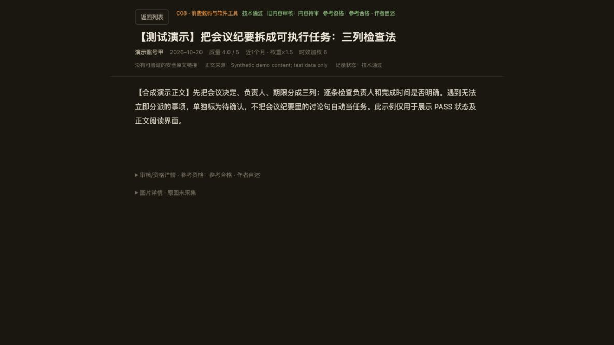
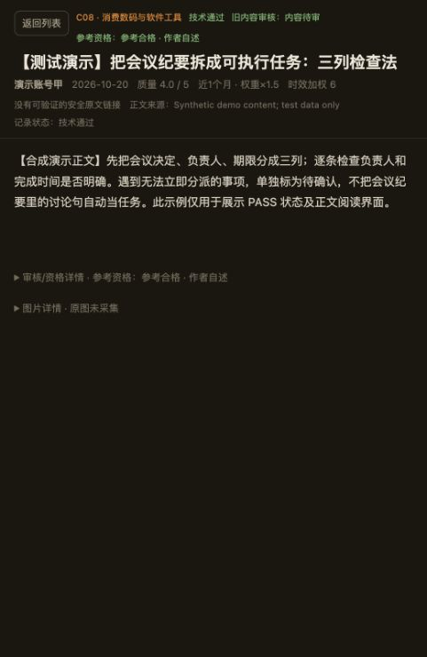
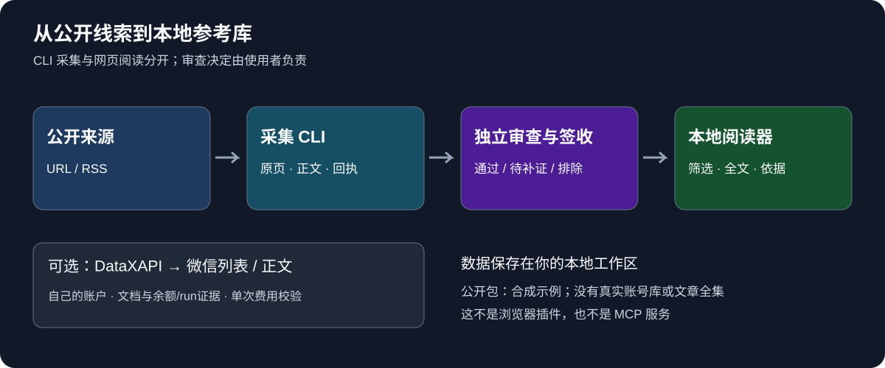

# 参考工作台 · 把文章链接变成能研究的资料库

**发现公开文章 → 保存正文与来源 → 审核筛选 → 在本地专心阅读。**

适合需要积累选题、分析对标账号、比较工具或整理研究资料的个人创作者。你可以先用内置示例体验界面，再接入自己的公开来源。

[立即体验](#先把界面跑起来) · [组件构成](#这个仓库由什么组成) · [采集到阅读](#如何把自己的文章放进来) · [完整操作手册](docs/advanced-guide.md) · [下载预览版](https://github.com/soarsky1991/wechat-reference-workbench/releases) · [反馈](https://github.com/soarsky1991/wechat-reference-workbench/issues/new/choose)

> 这是 **Python 命令行工具 + 本地网页阅读器**。不是浏览器插件，也不是可直接安装到 Codex/Claude 的 MCP 服务。打开演示不需要 API key，不需要充值。

## 你会得到什么

| 你现在的问题 | 用工作台怎么做 | 留下的结果 |
|---|---|---|
| 收藏很多链接，之后找不到 | 按来源、主题、时间和正文状态筛选 | 一份可检索的名录 |
| 抓到内容，但不知道能不能用 | 把“技术抓取成功”和“参考质量合格”分开 | 通过／待补证／排除及理由 |
| 读长文时被列表和信息栏挤住 | 点击进入正文优先模式，用键盘阅读 | 标题、来源、正文；详情按需展开 |
| 多次尝试同一失败链接，浪费时间或额度 | 跨批次记录尝试，失败停止 | 可追溯的原始回执与停止原因 |

## 看看实际界面

下图是正在运行的阅读器，使用包内合成文章；不包含真实用户资料。



**怎么看：** 顶部保留来源与参考资格，正文直接开始；文章末尾展开审核依据或图片信息。“返回列表”恢复筛选上下文。Home / End / PageDown 可用于阅读长文。

<details>
<summary>查看窄屏阅读示例</summary>



</details>

## 先把界面跑起来

需要本机 Python 3；日常运行仅用标准库，**不用先执行 pip install 或 npm install**。最低 Python 版本未单独完成兼容性验收。

### 方法一：有 Git

```sh
git clone https://github.com/soarsky1991/wechat-reference-workbench.git
cd wechat-reference-workbench
python3 app/server.py --port 8791
```

### 方法二：下载 ZIP

从 [Releases](https://github.com/soarsky1991/wechat-reference-workbench/releases) 下载预览包，解压，在包含 `app/`、`collectors/` 的目录打开终端，再运行：

```sh
python3 app/server.py --port 8791
```

浏览器打开 **http://127.0.0.1:8791/** 。终端需保持运行；结束时按 Ctrl+C。若端口被占用，把命令和浏览器地址里的 `8791` 同时换成其他空闲端口。

### 第一次打开，按这三步体验

1. 看到 **3条合成文章**：参考合格、待补证、排除各1条。这是演示，不是下载附赠的真实文章库。
2. 点击一篇文章，查看正文；展开审核详情，观察“作者自述”和“独立实测”的区别。
3. 点“返回列表”，筛选“待补证”：应只剩1条，计入目标为0。

完成这三步后，你已跑通本地阅读器。**网页本身不会自动开始抓取；下面的 CLI 才负责采集。**

## 这个仓库由什么组成



| 组件 | 在哪里 | 负责什么 | 是否必需 |
|---|---|---|---|
| 本地阅读器 | `app/server.py`、`app/web/` | 提供本机网页、筛选和全文阅读 | 体验界面需要 |
| 采集 CLI | `collectors/cli.py` | URL/RSS发现、有限来源正文提取、尝试账本 | 接入自己资料时需要 |
| 来源适配与锁检测 | `collectors/native_adapters.py`、`subscription_gate.py` | 解析适配页面，发现已知订阅锁后停止 | CLI自动使用 |
| 审查与签收 | [REVIEW-WORKFLOW](collectors/REVIEW-WORKFLOW.md) | 由人或你自己的审查流程作决定，再校验和物化结果 | 正式参考库需要 |
| DataXAPI 适配器 | `collectors/datax_fallback.py` | 按官方契约获取微信列表/正文并核对费用 | **可选，需要自己的付费账户** |
| 合成示例 | `demo-workspace/` | 让你无需采集也能体验界面 | 已内置 |
| 测试与反馈 | `app/tests/`、`collectors/test_*.py`、`.github/` | 回归检查、问题与使用建议入口 | 维护时使用 |

**没有单独的“插件安装”步骤。** DataX 是可选的外部数据服务；WeRSS、Firecrawl、自动评分模型与账号登录系统没有打包在这个仓库里。

## 如何把自己的文章放进来

第一次建议只做一篇。普通采集当前适配 **Appinn 与少数派的公开页面**，不是任意网站或任意微信公众号的一键下载器。

### ① 建立候选名录

从一个公开 RSS 建立最多20条候选：

```sh
python3 collectors/cli.py discover \
  --workspace ../my-reference-data \
  --run-id first-feed \
  --feed 'https://sspai.com/feed'
```

这一步会读取 RSS；结果是候选，不是已取得的完整正文。URL手工输入方式见[进阶手册](docs/advanced-guide.md)。

### ② 获取公开正文，保留原始证据

```sh
python3 collectors/cli.py capture \
  --workspace ../my-reference-data \
  --run-id first-feed
```

返回结果会指出批次状态。每篇的 `source.html`、`body.txt`、`extraction.json` 和 `fetch-receipt.json` 保存在工作区 `runs/` 下，待审清单是 `pending-review.json`。

遇到订阅锁、重定向或抓取失败，批次会停止；原回执用于排查。适配器只覆盖已知结构，公开站点改变或网络状态都可能使本次失败。

### ③ 审查，再生成可阅读工作区

打开[审查与签收说明](collectors/REVIEW-WORKFLOW.md)，核对正文、身份、来源、事实和用途，形成自己的签收文件。**CLI不替你给文章质量打分，演示签收值也不能冒充真实审查。**

```sh
python3 collectors/cli.py render-signed \
  --acceptance /absolute/path/to/signed-acceptance.json \
  --output ../my-viewer
PUBLIC_WORKBENCH_DATA_DIR=../my-viewer python3 app/server.py --port 8791
```

`--acceptance` 必须指向你实际完成的签收 JSON，`--output` 必须是新目录；此步骤校验哈希与字段，生成网页可读取的数据。它不是把任何 CSV 拖进去就能自动审核的导入器。

### 微信文章与 DataX 怎么接？

DataX 属于**进阶付费路径**，不影响你先体验或使用普通公开来源。先看[DataX前置配置](collectors/DATAX-PREFLIGHT.md)，再按[完整操作手册](docs/advanced-guide.md)准备官方文档、当前余额及现有run证据。适配器支持列表 `list` 和正文 `get`，不会自动创建run或续费。

本版本的 DataX 适配器以 mock 进行费用与门禁验证；项目历史采集结果不等于每位新用户的账户都能成功。

## 已做过哪些验证

- **阅读路径：** 实际本地库38,452字符长文核对完整字数；首段可见，End/Home/PageDown/Tab、返回列表及窄屏路径有实际验收记录。
- **采集与费用护栏：** 公开包发布时 collectors 测试13项通过；费用回执超过授权上限会STOP，保留回执且不进入成功暂存。DataX测试使用mock，不靠重复付费调用验证。
- **案例背景：** 项目私有研究库累计571条有效名录、201篇合格正文、18个已核公众号；其中201篇含102篇微信来源、99篇发布者原站。这些资料**不在公开下载包里**。
- **成本：** 项目该采集阶段DataX实际花费$4.20；本地合成演示不调用DataX。模型token及费用不可归因，不给虚构数字。历史31份采集manifest也不是31轮全部成功测试。

本次 `0.2.1-preview.1` **只改善说明、导航与结构图，不新增采集来源或软件功能**。更细的测试记录见[test-results](test-results/verification-summary.md)，文档模拟评审见[用户体验评审](docs/UX-REVIEW-v0.2.1.md)。

## 常见问题

**为什么页面只有3篇？** 公开包提供合成示例。自己的资料通过签收与 `render-signed` 生成新工作区，再用环境变量指定。

**为什么启动后没自动抓文章？** 网页是只读阅读器，采集由CLI单独触发。先看上方三步流程。

**需要API key吗？** 看合成演示、使用普通公开来源不需要；使用DataX才需要自己的账户与前置证据。

**能绕过付费墙或验证码吗？** 不提供此能力。访问受限时保留原回执并停止。

**能当生产服务直接开放公网吗？** 当前定位是本机研究工具，默认只监听回环地址；不是已验收的多用户托管服务。

**长文、媒体有什么限制？** 超过800,000字符存在截断边界；普通采集只记录媒体引用，不下载图片。当前费用精度承诺限官方十进制字符串契约。最低Python版本及所有操作系统组合未全量验收。

## 反馈、贡献与许可

[报告问题](https://github.com/soarsky1991/wechat-reference-workbench/issues/new/choose)时写清：你在哪一步、运行命令、期望结果、实际结果；附合成最小示例即可。使用建议可到[Discussions](https://github.com/soarsky1991/wechat-reference-workbench/discussions)交流。

自有代码和原创说明采用[MIT](LICENSE)，保留[OpenReader归因](app/UPSTREAM.md)。真实文章、第三方图片、密钥及个人数据库不随包分发，开源软件许可不授予它们的转载权。
