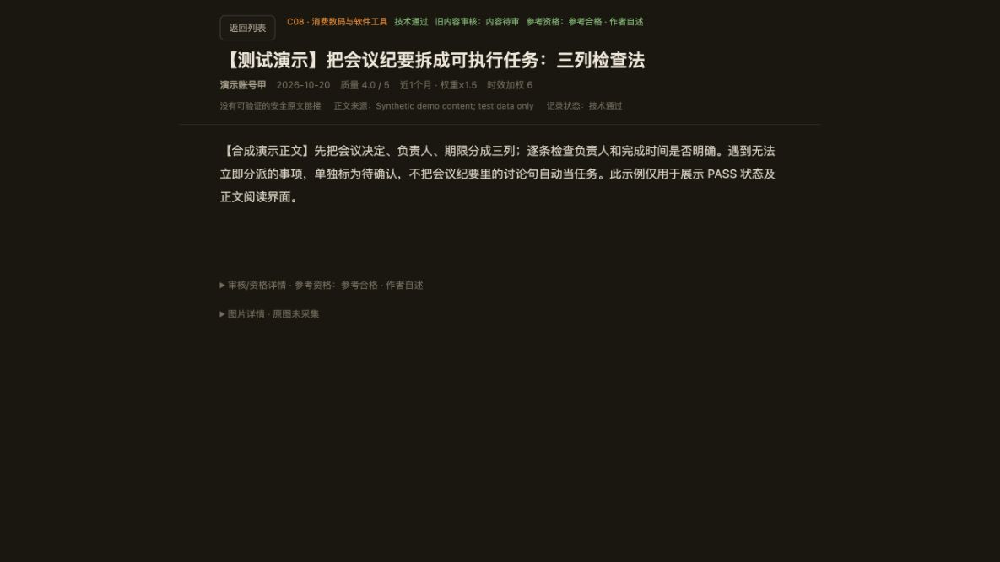

# 进阶使用与技术细节

这里介绍采集、签收与 DataX 配置。首次使用请先读[首页](../README.md)。

# 数字生活与办公工具参考工作台

**当前版本：0.2.3-preview.1。把公开文章线索整理成可检索、可审查、可追溯的本地参考库。** 包内仅有三条合成示例；不含真实公众号正文、真实账号、原图、凭据或生产数据库。`collectors/` 可以读取公开 Appinn/少数派页面，运行前请先看隐私、来源及停止规则；本次测试不访问外网、不收费；本地回环 HTTP 冒烟另行记录。下方截图来自运行中的合成演示，不包含真实文章或个人资料。

## 能做什么

1. 从用户提供的 Appinn/少数派文章 URL 建立最多20条元数据候选，或单次读取用户指定的公开 RSS/Atom feed。
2. 在独立工作区保存跨运行尝试账本；一个 URL/post ID 无论前次成功还是失败，都不再次请求。
3. 对被明确列为 `METADATA_CANDIDATE` 的条目按顺序逐篇直连。完整保存原始 HTML 与回执，先对整页检查已知订阅锁，再从适配过的闭合正文容器提取；首个失败/订阅锁/重定向/不完整响应写入 STOP，剩余项不请求。
4. 将成功提取内容标为 `PENDING_INDEPENDENT_REVIEW`。抓取成功不等于正文完整、质量通过或目标计数。
5. 只有给定独立审查记录并由审查人显式写入 `SIGNED` 签收后，才能把原样签收状态物化为新的本地 viewer 工作区。该步骤不打分、不改判、不准入生产库。
6. 可选 DataXAPI 单次兜底，仅支持官方契约中明确的微信文章 `get` 与账号文章 `list` 两个 GET；必须先给出当前 balance、已存在 active run、额度、文档哈希、精确请求 scope 与单次确认。工具不创建 run、不自动刷新余额，也不自动续页。

这个包不替代逐篇人工/代理独立审查；正文质量、事实核验、使用目的、效果声明、日期冲突及来源权利都要保留审查证据。publisher-native 内容标注为原站参考资料，不冒充同篇微信原文或公众号账号覆盖。

## 先看使用效果



点击文章后进入独立阅读模式；按 Home/End/PageDown 阅读长文，点“返回列表”继续筛选。正文后方可展开审核依据和图片详情。界面保留“作者自述”和“独立实测”的区别，待补证文章不计入合格数。

真实库38,452字长文已核对完整字数并用键盘到达末尾；窄屏检查也通过。截图仅使用合成短文，不公开真实参考库内容。

## 快速开始：合成演示 viewer

需要 Python 3 标准库，无需安装依赖：

```sh
python3 app/server.py --port 8791
```

浏览器打开 `http://127.0.0.1:8791/`。默认仅监听 IPv4 回环地址；拒绝非 localhost Host 与跨源 Origin。列表、正文、计数和 SQLite 均只读。端口被占用时换另一个本机端口；不要绑定 `0.0.0.0` 或把工作区暴露到局域网。

显式选择外部本地 viewer 工作区：

```sh
PUBLIC_WORKBENCH_DATA_DIR=/absolute/path/to/signed-workspace python3 app/server.py --port 8791
```

设置此变量后，程序仅读指定工作区，不自动回退到演示数据。不要分享含真实正文的目录或公开运行截图中的个人路径。

## 可携带 CLI 流程

原始采集产物与运行账本应放在包外、访问受限的本机工作区。使用新 run ID；不要手工删除/重置 `state/attempt-ledger.json`，否则会丢失跨运行防重证据。

### 1. 发现元数据

用户给定 URL（此命令不发文章请求）：

```sh
python3 collectors/cli.py discover \
  --workspace /absolute/path/to/private-workspace \
  --run-id sample-001 \
  --url 'https://sspai.com/post/123456'
```

或一次读取一个用户指定的公开 feed：

```sh
python3 collectors/cli.py discover \
  --workspace /absolute/path/to/private-workspace \
  --run-id sample-002 \
  --feed 'https://sspai.com/feed'
```

Feed 读取会发一次普通 GET；RSS/Atom 日期只作为列表观察字段，不自动作为可靠发表日期。发现候选最多20条，去除当前 feed 内重复的稳定身份，并标记本地尝试账本已有记录。支持域名严格限 `appinn.com` 与 `sspai.com`；SSPai 使用 `/post/<数字ID>` 稳定路径。

### 2. 单次正文捕获

```sh
python3 collectors/cli.py capture \
  --workspace /absolute/path/to/private-workspace \
  --run-id sample-001
```

每个候选最多一次默认 urllib GET：无代理、无自定义 UA、无 Cookie、无 Referer、不跟随重定向；没有浏览器登录、JS、图片或媒体请求。当前批次第一个非200、重定向、响应不完整、正文结构未闭合、已知订阅锁或解析错误即持久 STOP，后续 URL 留在 `unattempted_indices`。跨 run 的成功/失败 URL 和 SSPAi post ID 都从同一个账本拦截；不用换参数或新 run 绕过失败。

每篇文件写在 `runs/<run-id>/article-*/`：

- `source.html`：原始回包字节；
- `body.txt`：提取正文，保留代码和原始文字内容边界；
- `extraction.json`：容器闭合范围、标题/作者/日期来源证据、正文/原HTML哈希、媒体引用清单；
- `fetch-receipt.json`：HTTP、最终 URL、完整性、请求方式及停止/重试记录；
- `pending-review.json`：`Q=null`、`counts_toward_target=false` 的待独立审查清单。

已支持的正文根是 Appinn `div.entry-content` 与 SSPai `div.article-body`，先对整个原始 HTML 检查已知订阅锁，再解析闭合根。锁检测器只识别已知样式，未命中不证明没有其他访问限制。媒体只记录页面中的引用，不下载。作者效果一律由审查者标为 `SOURCE_REPORTED`，未独立操作的软件标为 `NOT_TESTED`。

### 3. 独立审查与人工签收

按 [`collectors/REVIEW-WORKFLOW.md`](../collectors/REVIEW-WORKFLOW.md) 审原始 HTML、正文、回执、完整性、题目兑现、引文位置、日期、事实和用途。审查记录保留 `PASS / NEEDS_EVIDENCE / EXCLUDE`、逐项 Q 和证据；抓取 CLI 不生成 Q，也不修改独立结论。

仅在审查人已作出决定并明确签收后，准备一个 `public-workbench-signed-acceptance/v1` JSON：`signoff.status="SIGNED"`、审查人、签收时间、时效基准 `as_of`（带时区）和完整 `record_ids`；每行包含准确正文、UTF-8 body SHA、已审 `reference_status`、Q、理由、证据路径和 `counts_toward_target` 显式布尔值。PASS 的 Q 必须至少3.5，只有审查人签收的 PASS 才可计数。NEEDS 与 EXCLUDE 可展示但不能计数。使用新输出目录：

```sh
python3 collectors/cli.py render-signed \
  --acceptance /absolute/path/to/signed-acceptance.json \
  --output /absolute/path/to/new-viewer-workspace
PUBLIC_WORKBENCH_DATA_DIR=/absolute/path/to/new-viewer-workspace python3 app/server.py --port 8791
```

`render-signed` 会核验输入签收、正文 SHA、状态和 PASS Q，拒绝覆盖已有目录；它只将签收决定映射为 viewer 文件，不重新审核、不推断新资格、不修改原始库。演示测试用的合成 SIGNED 记录不属于真实审核。

## DataXAPI 微信正文兜底（可选，默认不调用）

适配器按 2026-11-07 已审核公开契约实现，catalog revision `3efbf7080dda485f`、pricebook 12。被审核的是三份官方原始文档合同指纹：`agents.md=4a515424…59eb74`、`openapi.json=82cad987…87765`、`prices.json=9742e226…e9a4`，并核对端点 schema、计费差异和 run/header 字段。`snapshot.json` 是每次 prepare 新生成的本地证据：抓取时间会变，但必须绑定上述固定原文 SHA 和合同 revision，且不超过6小时；不再依赖项目内部文件夹或含旧抓取时间的 snapshot SHA。完整原文不随包分发。

新用户先创建空的本地缓存目录并运行明确的公开文档准备命令：

```sh
python3 collectors/cli.py prepare-docs \
  --cache-dir "$HOME/.local/share/public-workbench/datax-contracts/2026-11-08-run-01"
```

这个命令会对官方固定 URL `https://dataxapi.com/agents.md`、`/openapi.json`、`/prices.json` 各请求一次；不带 Cookie/Referer/代理、不跟随重定向，不调用账户/API、不收费。每份返回原文必须与已审核 SHA 完全一致，且当前 OpenAPI、pricebook、agents 文本交叉核验通过，才写入所选目录中的三个原文和新 `snapshot.json`。遇到 hash、schema、价格或 revision 漂移会立即停止，不留下可用的新缓存；保留旧缓存，交由维护者重新审合同后版本化固定新指纹。运行时可用 `--docs-dir` 指到该缓存，或设置 `PUBLIC_WORKBENCH_DATAX_DOCS_DIR`；无 docs cache 即 fail closed。

当前支持的操作与费用口径：

| 操作 | 端点 | 最高费用 | 空结果 | 未找到 |
|---|---|---:|---:|---:|
| `get` | `/v1/wechat_mp/articles/get` | $0.02/次 | $0 | 可能 $0.02，不能假设免费 |
| `list` | `/v1/wechat_mp/accounts/articles/list` | $0.02/次 | $0.02 |

`wechat_mp.accounts.search` 不在适配器白名单内。一个 run 由操作者在外部按官方 `POST /v1/runs` 契约预先建立；本包只接受已存在 run 的新鲜 GET 读回证据，不会创建、续期、换 run 或执行搜索。调用门禁要求：

- 当前官方四份文件的固定 SHA、公开契约验证状态和 catalog/pricebook revision 完全匹配；
- 不超过6小时的 `/v1/account` 余额响应文件与 `/v1/runs/{id}` active-run 响应文件；两份文件 SHA 与观察时间写入 preflight；
- 明确绑定唯一 operation、完整参数、当前 task ID/revision、run ID、step/iteration、价格上限及单次人工批准；
- `DATAXAPI_API_KEY` 只从环境读取；默认 urllib 禁用代理、不跟随重定向；持久化单次尝试后只发一个 GET。
- 成功回包金额须通过有界有限 `Decimal` 校验，币种必须精确为 USD，金额不得超过本次授权 cap；超限或费用字段异常会保留回执、将账本置 STOP、禁止重试和 staging。

预先准备 `public-workbench-datax-preflight/v1` JSON 的字段格式见 [`collectors/DATAX-PREFLIGHT.md`](../collectors/DATAX-PREFLIGHT.md)。它必须附上新 cache `snapshot.json` 的 SHA、固定原文哈希、current balance/run 原始响应文件及哈希/时间、精确 task scope 和显式批准。仅在明确希望由你本人执行这一笔调用时，使用：

```sh
python3 collectors/cli.py datax-once \
  --workspace /absolute/path/to/private-workspace \
  --preflight /absolute/path/to/preflight.json \
  --docs-dir "$HOME/.local/share/public-workbench/datax-contracts/2026-11-08-run-01" \
  --operation get \
  --params-json '{"url":"https://mp.weixin.qq.com/s?..."}' \
  --confirm-paid-transfer
```

上例参数必须由操作者替换为具体完整 URL。执行前须由本机安全方式把 `DATAXAPI_API_KEY` 注入当前进程环境；不要把真实 key 放进命令参数、README、preflight 或 shell history。成功回包保存在私有工作区的 `datax-receipts/` 与 `datax-staging/`，标为待独立审查，不写 CSV/SQLite/approved。HTTP 200 或 list 成功不代表正文合格。每个操作+参数 scope（包括失败）跨 run 只允许一次。若扣费未知，先用原 request ID 只读回执命令；绝不再次发原请求：

```sh
python3 collectors/cli.py datax-check-receipt \
  --workspace /absolute/path/to/private-workspace \
  --receipt 'datax-receipts/<原回执文件>.json'
```

本包没有连接账户、创建 run 或实调 DataX；以上 prepare-docs/call 流程仅用 mock transport 测试。实际 API 价格可能变化，原文 SHA 或 schema 变化会 fail closed，需维护者重新阅读官方契约、明确批准新的固定指纹并补对应测试；不要删掉哈希门禁或复用历史 optional-run helper。

## 演示计数、费用与时效

| viewer 状态 | 合成示例数 | 目标计数 | 含义 |
|---|---:|---:|---|
| PASS | 1 | 1 | 只演示签收状态与正文哈希联动 |
| NEEDS_EVIDENCE | 1 | 0 | 仍待补证 |
| EXCLUDE | 1 | 0 | 明确不计入 |

本地合成演示不调用第三方服务。真实采集的费用取决于服务商和请求范围；列表条数与合格正文数分开统计。

程序保留原始发表时间证据和观察时间的区别；列表 `updated` 不会升格为发布时间。日期缺失/冲突保留为空或待证，不猜日期。界面的演示旧样例只是合成展示，不给真实时效结论。

## 数据、隐私和运行边界

- 原始正文、provider 回包和请求回执留在包外的用户私有工作区；这些文件可能包含文章全文，请按原始来源和适用的保存/访问规则限制权限。CLI不会上传它们。
- 外部 viewer 工作区只由 `PUBLIC_WORKBENCH_DATA_DIR` 显式指定；服务使用 SQLite `mode=ro`。`render-signed` 是唯一会创建一份新 viewer 工作区的命令，并且只消费显式签收结构。
- 不执行文章、命令、插件或下载内容；不登录、不传 Cookie、不处理真实凭据、不下载媒体、不绕过付费/访问限制。
- `.github/ISSUE_TEMPLATE/wechat-reference-bug.yml` 与 `wechat-reference-idea.yml` 是仓库现有反馈表单的仓库相对引用；未复制到本包或修改。填写反馈时不得附原文、凭据或个人数据库。
- `collectors/` 不是完整生产抓取平台，不包含账号系统、自动审查、准入器、队列服务、远端部署或覆盖所有站点的通用解析器。

## 测试及当前状态

无需安装依赖。执行离线集成与相关 UI 测试：

```sh
python3 -m unittest discover -s collectors -p 'test_*.py' -v
python3 -m unittest discover -s app/tests -p 'test_*.py' -v
node --test app/tests/test_review_display.cjs app/tests/test_reader_display.cjs
```

离线集成使用合成 RSS/HTML、mock transport、临时 SQLite 与本机回环 HTTP server，覆盖成功捕获、整页锁/失败 STOP、跨 run 防重、待审与显式签收 viewer；DataX 只用 mock。该测试不证明真实站点可访问、收费账户有效、版权许可成立或人工审查已经完成。测试摘要与运行日志见 [`test-results/verification-summary.md`](../test-results/verification-summary.md)。

公开包仅含代码、合成演示和说明，不含真实数据库；默认仅在本机运行。

## 许可与来源

自有代码、原创说明与包内合成演示资产使用 [MIT License](../LICENSE)。OpenReader 的完整 MIT 通知继续保留；适配范围与归因见 [UPSTREAM](../app/UPSTREAM.md) 和 [NOTICE](../NOTICE)。真实文章、第三方图片和服务商资料不随包分发，也不因软件开源获得转载权。

## 反馈与参与

遇到问题请通过 [Issues](https://github.com/soarsky1991/wechat-reference-workbench/issues) 提交复现步骤；建议和经验可在 [Discussions](https://github.com/soarsky1991/wechat-reference-workbench/discussions) 讨论。请只使用合成或已获授权的最小样例，不附密钥、Cookie、原文全文或私人数据库。

## 已知适用边界

当前真实库抽样最长正文为38,452字符。服务端对超过800,000字符的内容存在截断边界，不能把本版本当作超长文无损归档器。DataX费用检查以冻结官方契约中的十进制字符串为准；契约外JSON裸小数不承诺高精度。采集适配器覆盖有限公开来源，遇访问限制停止，不替代来源授权。
