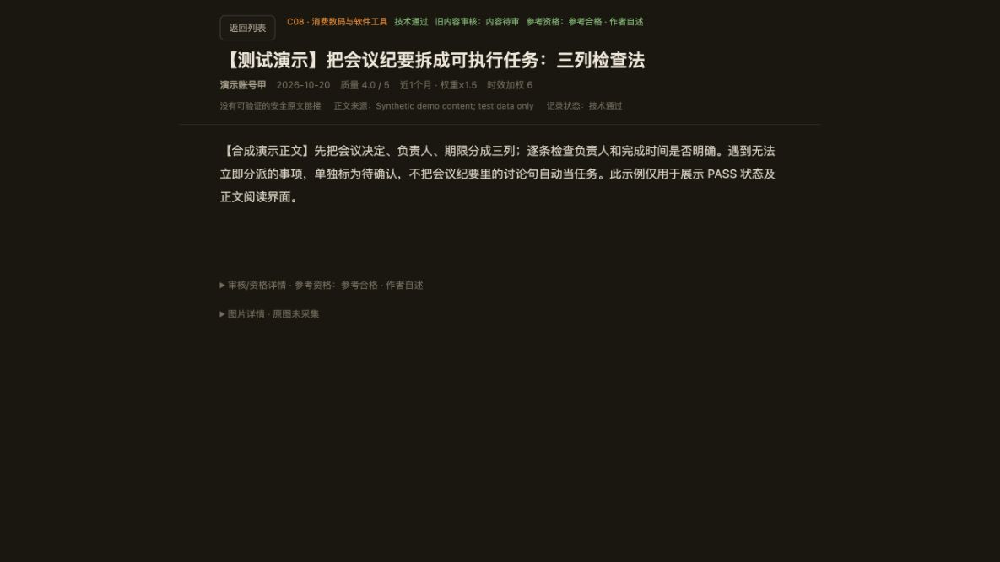
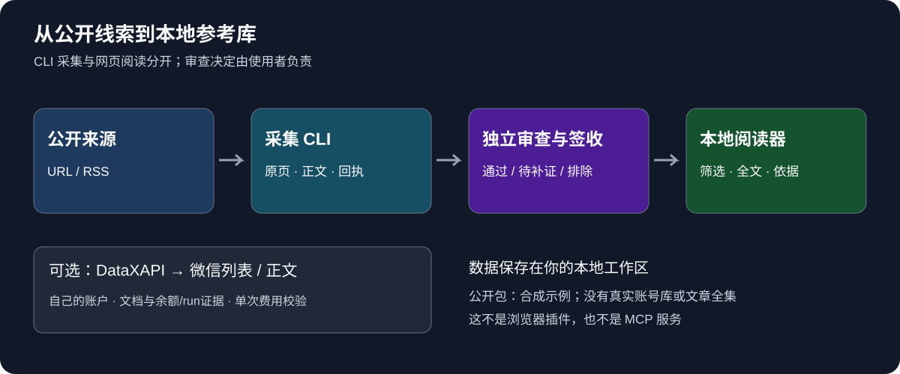

# 从一组链接到可复查的参考资料 · 图文导览

[回到首页](../README.md) · [立即跑离线例子](first-reference.md)

跟着名录、正文和审核依据三个步骤，判断它是否适合自己的资料整理。界面图使用原版本已验证的合成演示，流程图用于说明模块关系。

## 你先选哪条路径

| 你的状态 | 现在做什么 | 看到什么算成功 |
|---|---|---|
| 只想判断适不适合 | 按首页启动内置演示 | 3条合成文章，PASS/待补证/排除各1条 |
| 想理解自己的资料怎样进库 | 跑[完整离线例子](first-reference.md) | 从填好的合成签收JSON生成1条新工作区 |
| 已有真实公开文章来源 | 按[完整手册](advanced-guide.md)发现、采集与审查 | 保存正文和回执，完成真实签收后展示 |
| 想帮助改进 | 看[贡献指南](../CONTRIBUTING.md) | 可复现问题或小范围PR，附明确验证结果 |

## ① 名录：先筛选，不把所有抓取都当作合格

首页的参考资格、来源、时间和正文状态服务不同判断。抓取成功只能证明技术路径；查看待补证记录时，合格计数不增加。演示只有3条合成记录，真实历史文章库没有公开。

## ② 正文：先阅读，再按需展开依据

文章标题、来源和资格先出现，正文紧随其后。Home/End/PageDown用于长文阅读，返回列表恢复筛选。该截图来自原阅读模式验收，不代表新抓取文章。

## ③ 依据：保留为什么通过、为什么待核

合成PASS只用来解释结构；真实资料必须核来源、正文完整性、关键事实和具体用途。参考合格不等于效果已由我们复现。演示签收人不是实际审核人，不能把示例批量套入真实文章。

## 什么已经有，什么还没有

| 状态 | 能力 |
|---|---|
| 已提供 | 本机只读阅读器、有限来源CLI、跨批次尝试账本、签收校验与工作区生成 |
| 可选且有前置条件 | DataX列表/正文适配，使用自己的账户与run/余额/文档证据 |
| 人工或你的审查流程负责 | 文章质量决定、事实核对、素材权利和真实签收 |
| 未提供 | 浏览器插件、MCP服务、通用书签导入、公开在线演示、自动审查、无人值守公众号全集采集 |

## 这套方法最终帮你得到什么

一份能找到原始来源、能解释参考资格、能回看正文与失败回执的资料库。下一步可以在自己的授权资料上做选题研究；工作台不会自动替你写稿或发布。

[开始体验](../README.md#先把界面跑起来) · [做第一个离线例子](first-reference.md) · [报告卡点](https://github.com/soarsky1991/wechat-reference-workbench/issues/new/choose)
